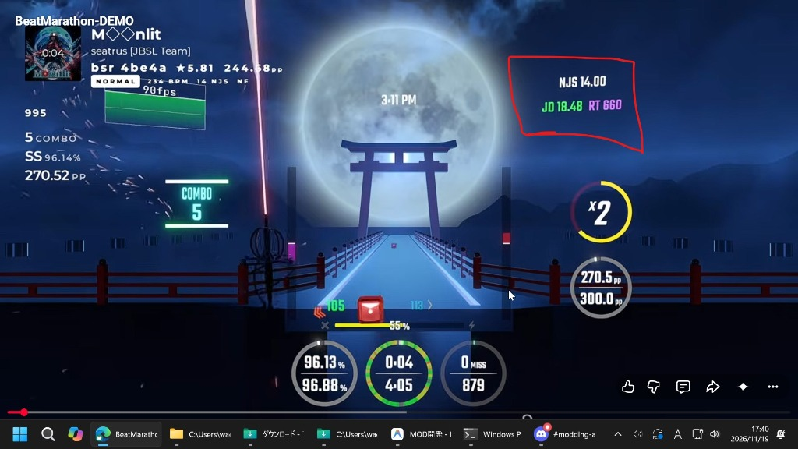

# NjsJdRtDisplay

Beat Saber 1.40.8 向け HUD拡張MODです。  
譜面プレイ中にリアルタイムの **NJS（譜面速度）**、**JD（ジャンプ距離）**、**RT（反応時間/ms）** を空間内のフローティングパネルに表示します。

A HUD extension mod for Beat Saber 1.40.8.  
Displays real-time **NJS (Note Jump Speed)**, **JD (Jump Distance)**, and **RT (Reaction Time in ms)** on an in-game floating panel during gameplay.

---

> [!WARNING]
> ### 免責事項 / Disclaimer
> 
> 本MODは wacky が個人的に楽しむために作成・カスタマイズしているものです。  
> そのため、他のPC環境や将来のBeat Saberバージョンでの動作は保証できません。  
> 導入およびご利用はすべて自己責任にてお願いいたします。
> 
> This mod is created and maintained by wacky purely for personal enjoyment.  
> As such, proper operation in other environments or future Beat Saber versions is not guaranteed.  
> Please use this mod entirely at your own risk.

---

## 🎯 特徴 / Features
- **見やすい配色とレイアウト / Clear Color Scheme & Layout**:
  - 上段中央 / Top Center: **NJS**（白色 / White）
  - 下段左 / Bottom Left: **JD**（視認性の高いエメラルドグリーン `#40FF66` / Emerald Green）
  - 下段右 / Bottom Right: **RT**（視認性の高い明るい紫色 `#D978FF` / Bright Purple）
  - 文字サイズは 6.5 に統一、JDとRTの間隔を約2.5ユニットに寄せて視線移動を最適化。
  - Unified font size (6.5) with compact spacing to minimize eye movement.
- **ゲーム内設定対応 / In-game Settings**:
  - `Mod Settings` メニューからHUDの表示位置（X, Y, Z）や有効/無効を自由に変更可能（`UserData/NjsJdRtDisplay.json` に自動保存）。
  - Freely adjust HUD position (X, Y, Z) and toggle visibility via in-game Mod Settings.

---

## 🔧 前提MOD / Prerequisites
- [BSIPA](https://github.com/beat-saber-modding-group/BeatSaber-IPA-Reloaded) (4.3.0+)
- [SiraUtil](https://github.com/Auros/SiraUtil) (3.1.0+)
- [BeatSaberMarkupLanguage](https://github.com/monkeymanboy/BeatSaberMarkupLanguage) (1.11.0+)

---

## 📦 インストール方法 / Installation
1. `NjsJdRtDisplay.dll` を Beat Saber の `Plugins` フォルダへ配置してください。
2. Place `NjsJdRtDisplay.dll` into your Beat Saber `Plugins` folder.
